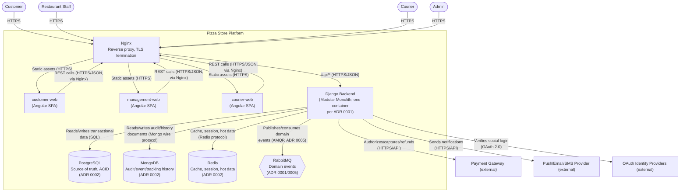

# C4 Container Diagram

Shows the containers inside the Pizza Store Platform system boundary (see
[c4-context.md](c4-context.md) for the actors and external systems around it), per the
Modular Monolith + EDA decision (ADR 0001), the polyglot persistence decision (ADR 0002), and
the repository layout (master prompt §7: `frontend/customer-web/`, `frontend/management-web/`,
`frontend/courier-web/`). Component-level detail (inside the Django backend or one Angular
app) is deferred to the phase that implements each module, since it requires real code
structure to be meaningful.

## Containers

| Container | Technology | Role |
|---|---|---|
| Nginx | Nginx | Single edge reverse proxy; terminates TLS, serves each Angular app's static build, and proxies `/api/*` to the Django backend. |
| customer-web / management-web / courier-web | Angular SPA | Three separate frontend apps per master prompt §7, each talking to the same backend API; not three containers of logic, just three distinct UIs for three actor groups. |
| Django Backend | Django (Python), Modular Monolith | One deployable container housing every bounded-context module (identity, orders, payments, kitchen, etc. — ADR 0001); internal module boundaries are enforced in code (`import-linter`, ADR 0004), not by separate deployment units. |
| PostgreSQL | PostgreSQL | Source of truth for transactional, ACID-requiring data (ADR 0002). |
| MongoDB | MongoDB | Flexible document data: audit records, order event history, delivery tracking history (ADR 0002) — also the durable store Event Replay reads from (ADR 0005). |
| Redis | Redis | Hot, non-source-of-truth data: cache, session, rate limiting, latest courier GPS coordinate (ADR 0002). |
| RabbitMQ | RabbitMQ | Cross-module domain event delivery via the Transactional Outbox pattern (ADR 0001, ADR 0005) — never used as a database. |

See [ADR 0001](../adr/0001-modular-monolith-and-event-driven-architecture.md),
[ADR 0002](../adr/0002-polyglot-persistence-postgresql-mongodb-redis.md), and
[ADR 0005](../adr/0005-event-topology-and-outbox-design.md) for the decisions this diagram
visualizes.
