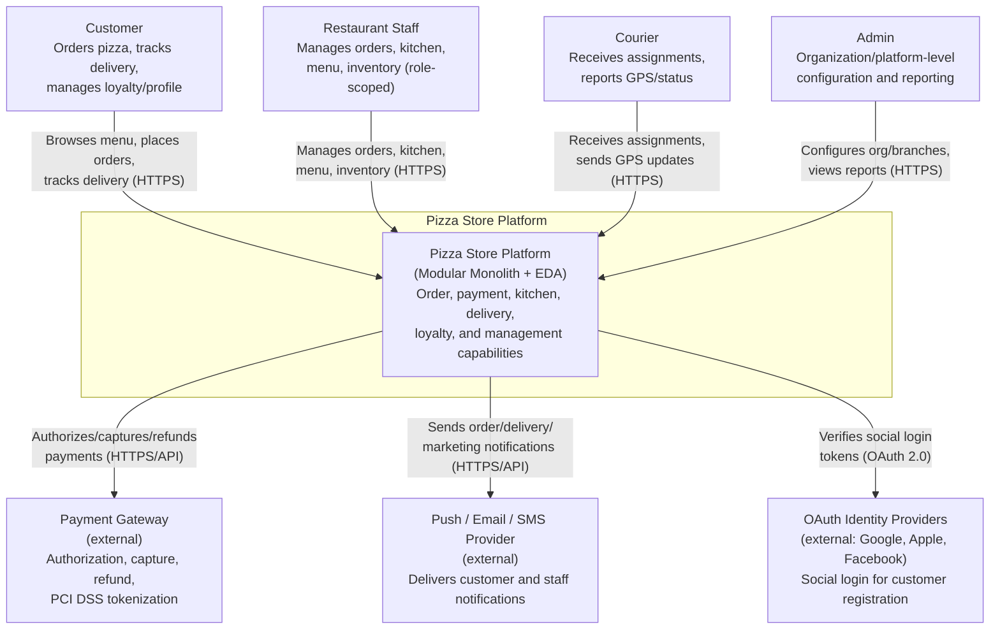

# C4 Context Diagram

Shows the Pizza Store Platform as a single system boundary, the actors who use it, and the
external systems it depends on. Per ADR 0001 (Modular Monolith + EDA) and ADR 0002 (polyglot
persistence), none of the platform's internal containers are shown here — that is the
[Container diagram](c4-container.md)'s level of detail.

## Actors

| Actor | Represents |
|---|---|
| Customer | The Guest/Customer/Verified Customer/Loyalty Member roles from ADR 0006 — anyone ordering pizza through the customer-facing apps. |
| Restaurant Staff | Every staff role scoped at the organization/restaurant/branch level per ADR 0006 (Organization Owner, Restaurant Manager, Branch Manager, Cashier, Kitchen Manager/Staff, Delivery Manager, Inventory Manager, Marketing Manager, Accountant, Customer Support) — collapsed into one actor at this level of detail since the Context diagram does not distinguish roles, only usage of the system. |
| Courier | The Courier role — a distinct actor because it uses a separate frontend (courier-web) and a materially different interaction (GPS/status updates) from other staff. |
| Admin | Super Admin — platform-wide operator, distinct from organization-scoped Restaurant Staff. |

## External systems

| System | Role |
|---|---|
| Payment Gateway | Processes authorization, capture, and refunds; card data is tokenized there and never stored by the platform (existing CLAUDE.md/master-prompt rule). |
| Push / Email / SMS Provider | Delivers the event-driven notifications described in master prompt §6 (order status, delivery, marketing/loyalty campaigns). |
| OAuth Identity Providers | Google/Apple/Facebook social login, one of the registration methods listed in master prompt §11. |

See [c4-container.md](c4-container.md) for what is inside the system boundary.
